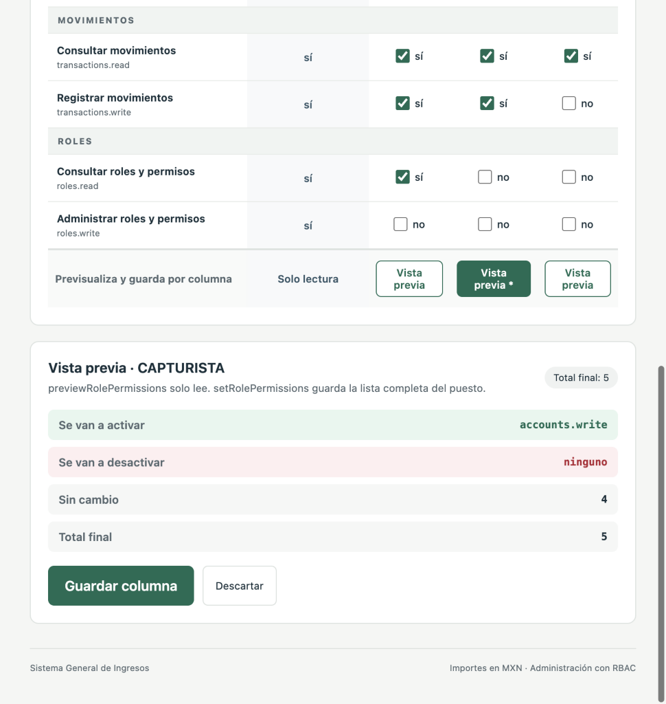
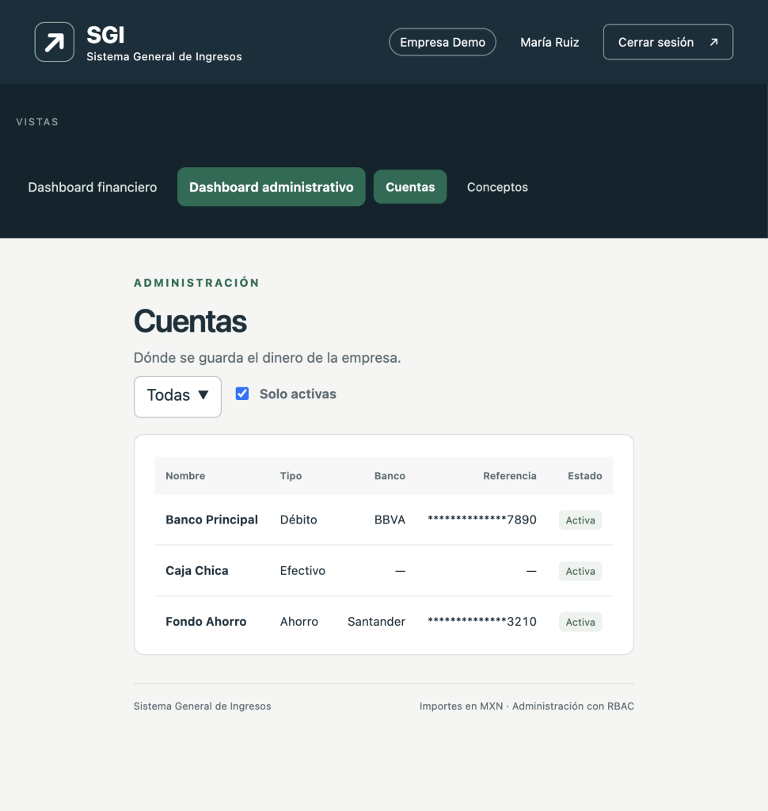
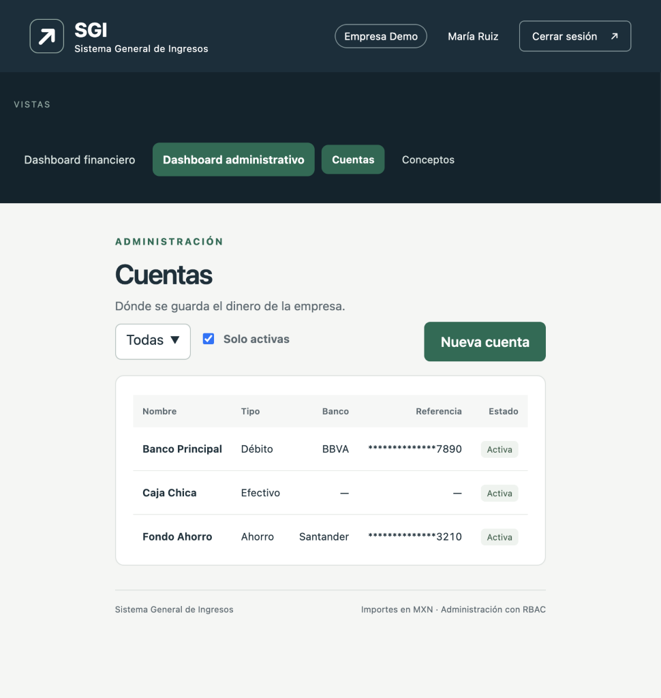
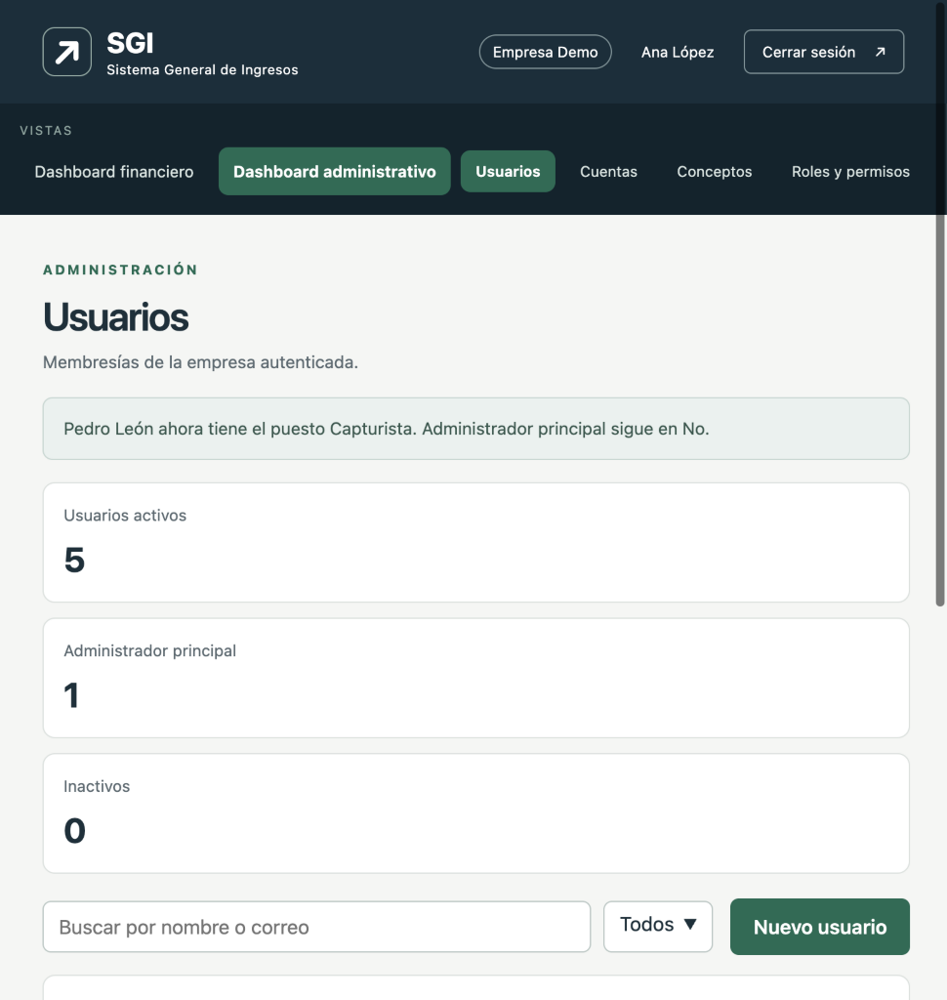
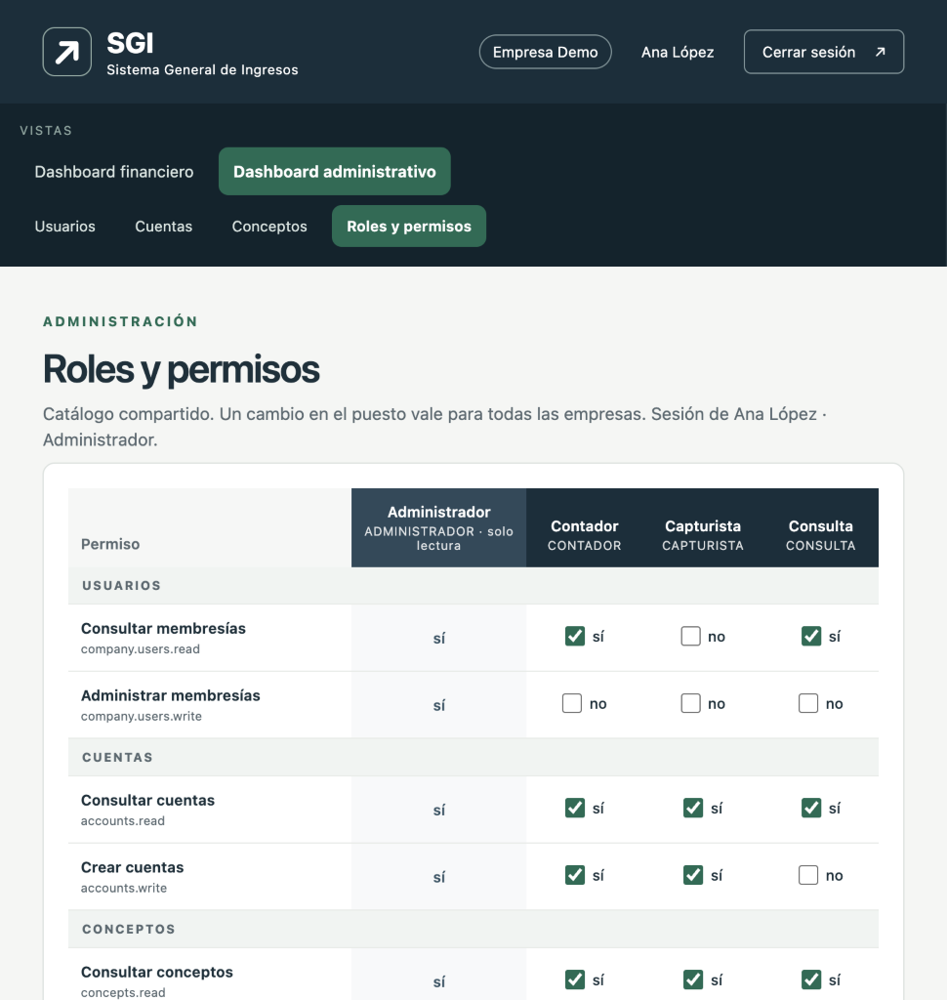
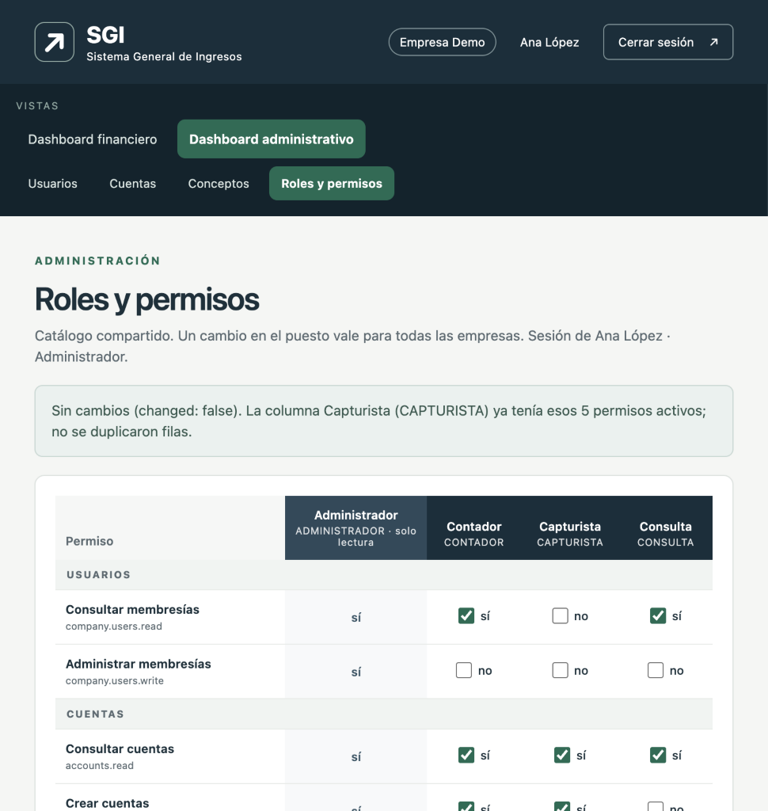
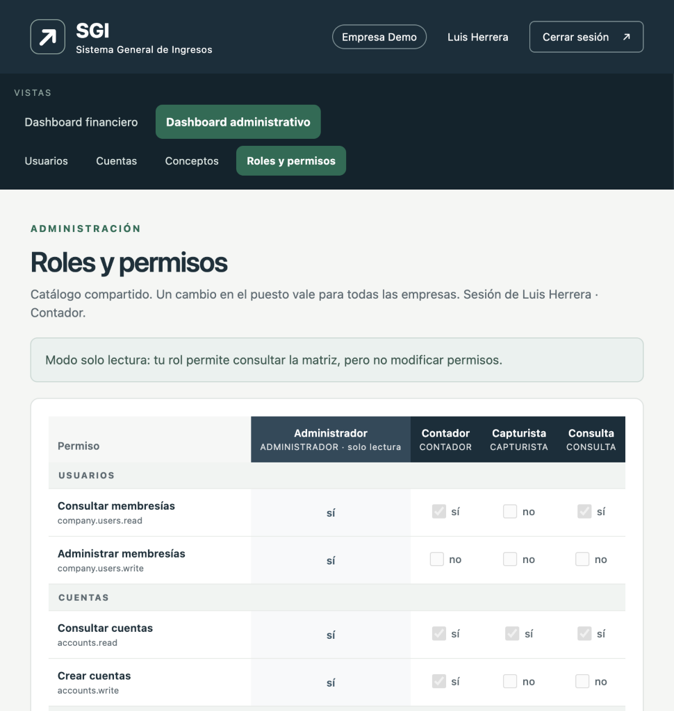

# Evidencias · Unidad III · Actividad 3 (Matriz de roles y permisos)

## 1. Matriz inicial coincidiendo con la sección 2.2

La pantalla **Roles y permisos** carga desde MySQL las cuatro columnas en orden (`Administrador` en solo lectura, `Contador`, `Capturista` y `Consulta`) y los diez permisos en cinco grupos coincidiendo exactamente con la matriz del Parcial II.

## 2. Columna de Capturista en GraphiQL (`rolePermissions`)

La consulta `rolePermissions(roleId)` en GraphiQL con `Authorization: Bearer <token>` devuelve los mismos cuatro permisos activos (`accounts.read`, `concepts.read`, `transactions.read`, `transactions.write`) que muestra la columna **Capturista** en el dashboard.

## 3. Vista previa anunciando activar `accounts.write`

Al marcar **Crear cuentas (`accounts.write`)** en la columna **Capturista** y pulsar **Vista previa**, `previewRolePermissions` anuncia activar `accounts.write`, desactivar `ninguno`, `4` sin cambio y `5` de total final sin escribir todavía en la base de datos.

## 4. Pantalla de Cuentas del capturista antes y después del guardado

Antes de guardar la columna **Capturista**, el capturista ve la tabla de **Cuentas** sin el botón **Nueva cuenta**; después de guardar `accounts.write`, el botón **Nueva cuenta** aparece para todos los usuarios con el puesto **Capturista**.

## 5. Cambio de puesto en Usuarios (Consulta → Capturista) sin mover la matriz

Al cambiar en **Usuarios** el puesto de la persona de **Consulta** a **Capturista** mediante `assignRole`, `isAdmin` permanece en `No` y la columna **Consulta** de la matriz conserva sus cuatro permisos intactos.

## 6. Segundo guardado de la misma columna (`changed: false`)

Al guardar por segunda vez la misma columna **Capturista** sin cambios, `setRolePermissions` responde `changed: false` y el dashboard informa que no hubo modificaciones ni se duplicaron filas en `role_permissions`.

## 7. Contador en solo lectura o Capturista sin el ítem de menú

Al iniciar sesión como **Contador** (`roles.read` sin `roles.write`), la matriz se muestra en modo solo lectura con casillas deshabilitadas y sin botones de guardado (mientras que un **Capturista** sin `roles.read` ni siquiera ve el ítem **Roles y permisos** en el menú).
